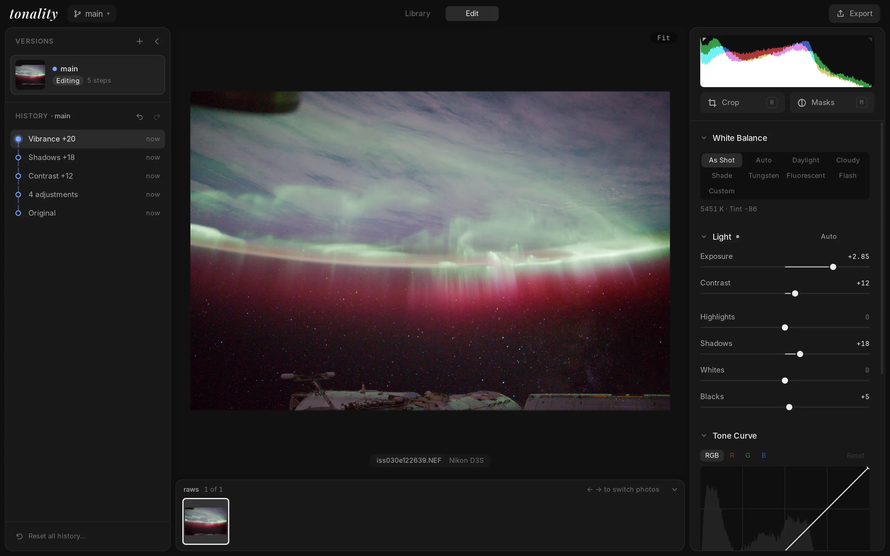

# tonality

[](https://github.com/cobysmckinney/tonality/actions/workflows/ci.yml)

A raw photo editor for the desktop, with a history that works like version control: every
change is a step you can go back to, and a photo can have several versions side by side.



<sub>Photo: aurora from the International Space Station (ISS030-E-122639), NASA, public domain.</sub>

## What it does

- **Raw files** from Sony, Canon, Nikon, Fujifilm, Olympus, Panasonic, Pentax and others, and
  DNG.
- **Library:** import folders, rate and flag photos, filter, and collect them in albums.
- **Edit:** white balance (presets, Auto, or your own), light, tone curve, colour and an
  eight-band colour mixer, sharpening and noise reduction, lens correction, crop and straighten,
  texture, clarity, dehaze, vignette and grain.
- **Masks:** gradients, a brush, and AI masks for the subject, sky, people, or an object you
  circle. The models run on your computer; photos never leave it.
- **Versions and history:** every edit is a step in the photo's history. Branch off a version
  to try another direction, compare two versions side by side, and copy settings between them.
- **Export:** JPEG, PNG or 16-bit TIFF, in sRGB or Display P3, or as an Ultra HDR JPEG, with
  the camera's metadata.
- **Colour:** [AgX](docs/agx.md) as the display transform, matching Blender's.

## Install

Installers for Linux (AppImage), macOS (Apple Silicon) and Windows are attached to each
[release](https://github.com/cobysmckinney/tonality/releases).

The builds are not signed, so macOS and Windows will warn before the first launch. After that,
tonality updates itself. Pick the Stable or Nightly channel in Settings (Ctrl+,). Updates
download in the background and install when you click **Restart to Update**. On Linux this
works for the AppImage.

## Build from source

You need [Rust](https://rustup.rs), [Node.js](https://nodejs.org) 24 and Tauri's
[system dependencies](https://tauri.app/start/prerequisites/).

```bash
npm install
```

```bash
npm run tauri dev
```

To build an installer for the system you're on:

```bash
npm run tauri build
```

Photos and their edit histories are kept in `~/Pictures/tonality Library`. Set
`TONALITY_LIBRARY` to use another folder, for example while developing.

## Development

The checks that CI runs on every pull request:

```bash
cargo test --workspace
cargo clippy --workspace --all-targets -- -D warnings
cargo fmt --all --check
npm test
npm run check
npm run format:check
```

`cargo fmt --all` and `npm run format` fix the formatting checks. The Rust tests also rewrite
the TypeScript types in `ui/lib/bindings` from the Rust ones; commit them when they change.

### Layout

| Path                     | What's there                                                                |
| ------------------------ | --------------------------------------------------------------------------- |
| `crates/tonality-core`   | Edit settings, history, colour maths, AgX, Auto, EXIF                       |
| `crates/tonality-raw`    | Raw decoding and lens data                                                  |
| `crates/tonality-render` | The develop pipeline: one WGSL shader for preview (WebGL) and export (wgpu) |
| `crates/tonality-ml`     | On-device models for AI masks                                               |
| `src-tauri`              | The desktop app: catalog, commands, export                                  |
| `ui`                     | The interface, in Svelte                                                    |
| `docs`                   | How the colour, Auto, presence and metadata features work                   |

### Working on it

[ROADMAP.md](ROADMAP.md) is the list of what's next and what's done. Work happens on a branch
from `main` and comes back through a pull request; the branch is deleted once it's merged.

### Releases

To cut a stable release, run `npm run release` (next patch), `npm run release -- minor`,
`npm run release -- major` or `npm run release -- 1.4.2`, or use **Actions → Release → Run
workflow** on GitHub. The [release workflow](.github/workflows/release.yml) bumps the version
on `main` (with [`scripts/version.mjs`](scripts/version.mjs)), commits and tags it, builds the
three installers, and publishes the release once all of them have uploaded. Pushing a `vX.Y.Z`
tag that matches `src-tauri/tauri.conf.json` still works too.

A [nightly](.github/workflows/nightly.yml) is built from `main` at 07:00 UTC whenever it has
changed, replacing the rolling [`nightly`](https://github.com/cobysmckinney/tonality/releases/tag/nightly)
prerelease. It's versioned as the next patch's prerelease (`0.1.1-nightly.20261121.42` after
`0.1.0`). Run `npm run release -- nightly` to build one now.

The app updates itself from these releases (Settings, Ctrl+,): the **Stable** channel follows
the latest release and **Nightly** the nightly. Each release carries a `latest.json` and
installers signed with the updater key. The public half is in `tauri.conf.json`; the private
half is the `TAURI_SIGNING_PRIVATE_KEY` repository secret (a passphrase, if the key has one,
goes in `TAURI_SIGNING_PRIVATE_KEY_PASSWORD`). If the key is lost, installed apps can't take
updates signed with a new one. They'd have to be reinstalled by hand, so keep a copy safe.

## Licences

tonality's code is under the [MIT licence](LICENSE). It also ships or downloads work under
other terms:

- **Lens data** from [lensfun](https://lensfun.github.io/), CC BY-SA 3.0
  (`crates/tonality-raw/lensfun`).
- **RAW decoding** by [rawler](https://github.com/dnglab/dnglab), LGPL-2.1, compiled into
  the app. Because tonality's source is public, you can rebuild it against a modified rawler.
- **AI mask models**, downloaded on first use. The sky and people model (SegFormer-B0) is
  licensed by NVIDIA for non-commercial use only.

The other Rust crates, ONNX Runtime and the frontend packages are under permissive licences
(MIT, Apache-2.0, BSD and similar) or MPL-2.0. Each installer includes `LICENSE` and
[`licences/THIRD-PARTY-NOTICES.txt`](licences/THIRD-PARTY-NOTICES.txt), which has the full
text of every licence, including the LGPL-2.1. After changing Rust dependencies, regenerate it
with `npm run licences` (needs `cargo install cargo-about`).
